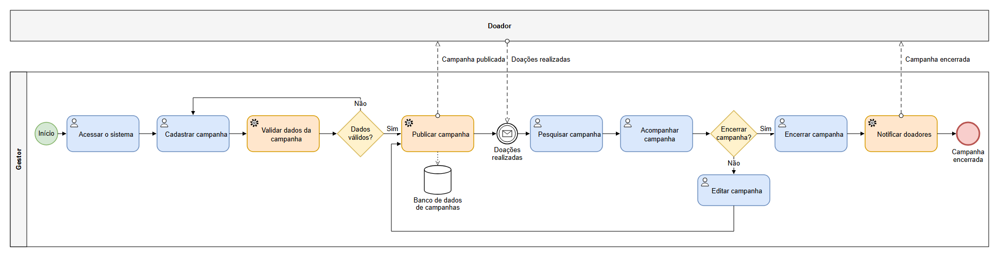
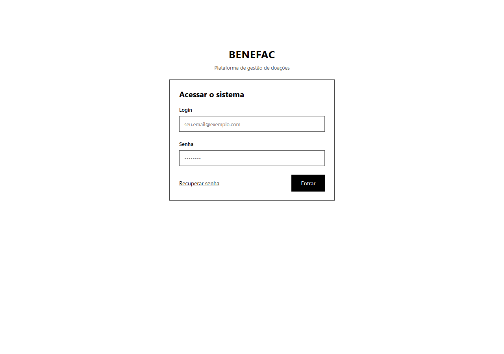
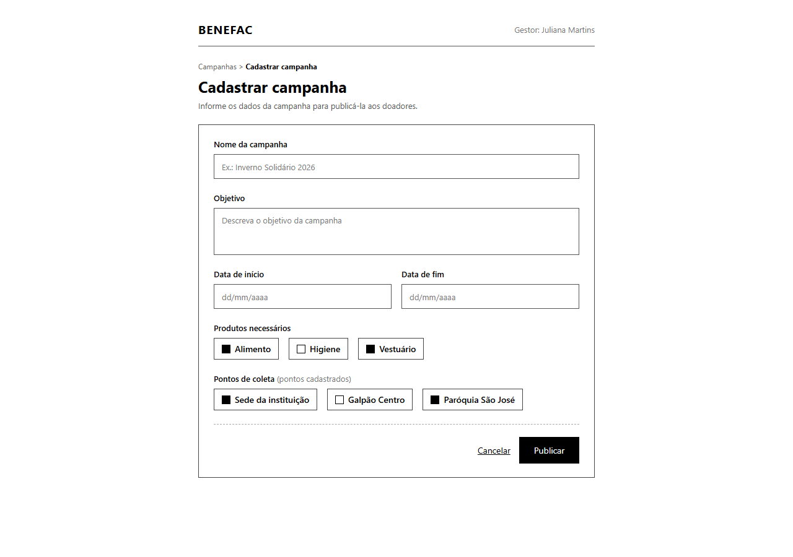
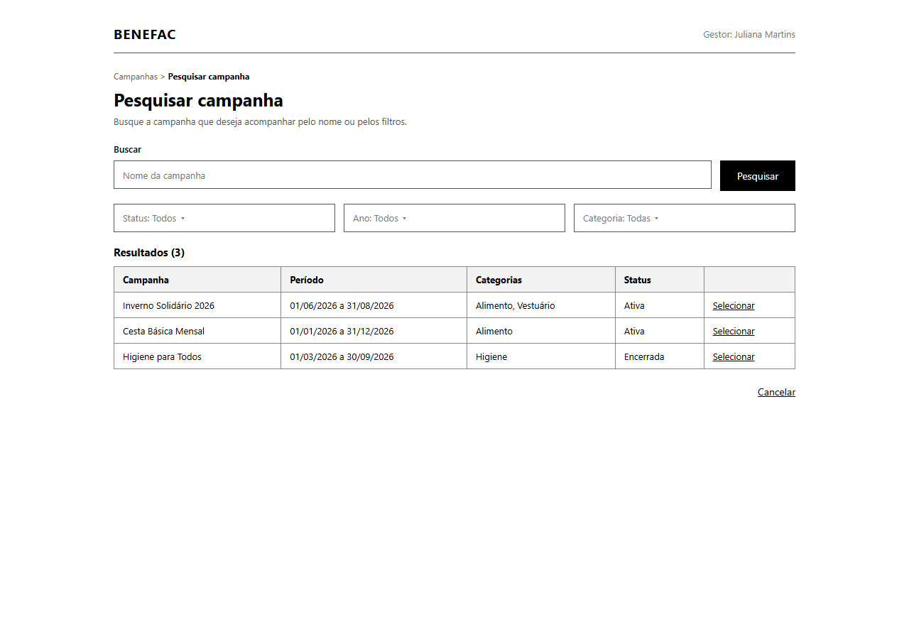
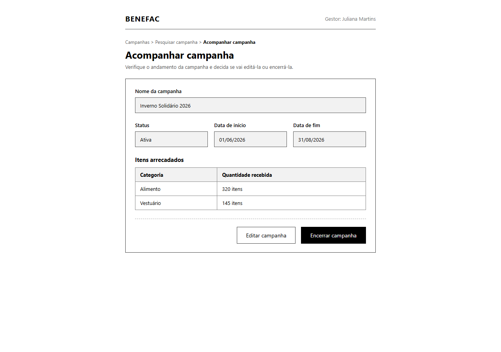
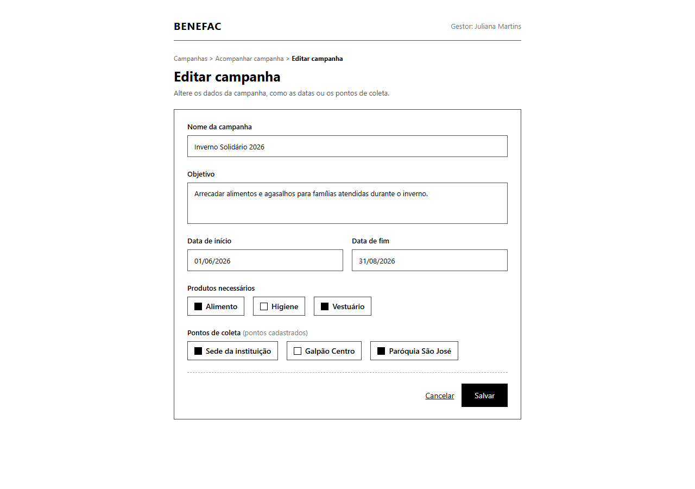
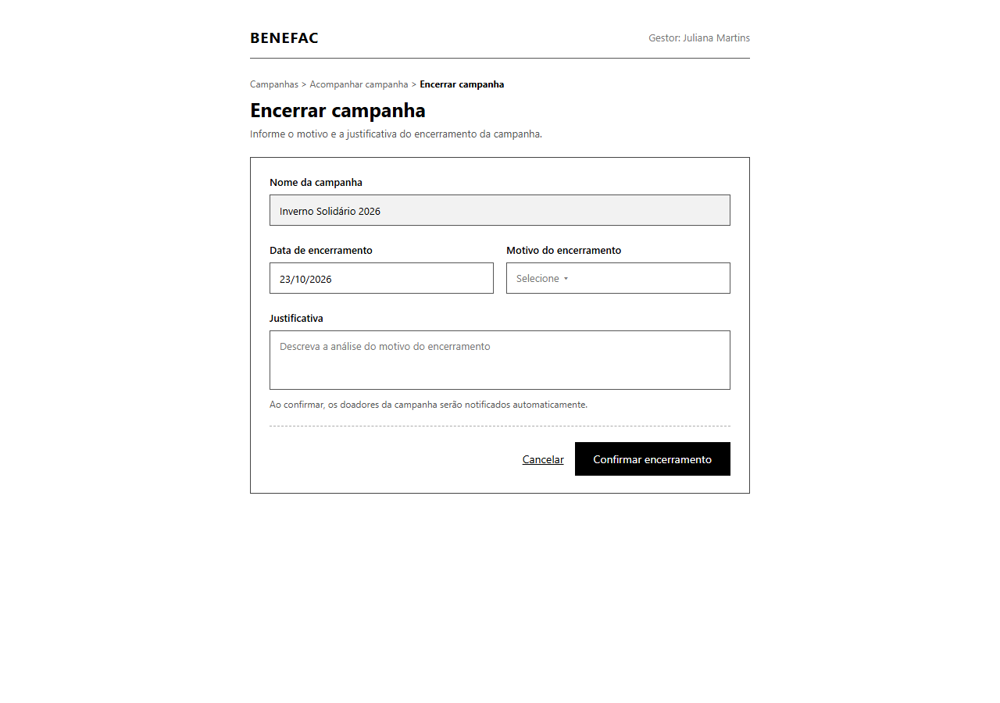

### 3.3.1 Processo 1 – GESTÃO DE CAMPANHAS DE DOAÇÃO

Este processo ocorre na Plataforma Web do BENEFAC e é realizado pelo Gestor/Coordenador Geral, a partir de computador ou notebook com conexão à internet, com a participação do Doador, representado como participante externo (caixa-preta), pois suas ações acontecem fora do controle do sistema. O processo tem início quando o Gestor acessa o sistema e, em seguida, cadastra a campanha. O sistema valida os dados da campanha de forma automática: se os dados não forem válidos, o formulário notifica o erro e o Gestor corrige o cadastro; se forem válidos, o sistema publica a campanha, gravando-a no banco de dados de campanhas, e a campanha publicada é comunicada aos doadores. Com as doações realizadas pelos doadores, o Gestor pesquisa a campanha e acompanha a campanha, decidindo se vai encerrar a campanha: se não, ele edita a campanha, alterando, por exemplo, as datas ou os pontos de coleta, e a campanha é publicada novamente e comunicada aos doadores; se sim, ele encerra a campanha, informando o motivo e a justificativa do encerramento, e o sistema notifica os doadores automaticamente. O processo é encerrado quando a campanha é encerrada, e o produto gerado é o Registro de Campanha.

Em seguida, apresenta-se o modelo do Processo 1, descrito no padrão BPMN.

##### 3.3.1.1 Modelagem BPMN

##### 3.3.1.2 Detalhamento das atividades do usuário (user tasks)

#### Detalhamento das atividades

**Atividade 1 – Acessar o sistema**
 
| **Campo**  | **Tipo**        | **Restrições** | **Valor default** |
| ---        | ---             | ---            | ---               |
| login      | Caixa de Texto  | obrigatório; formato de e-mail | |
| senha      | Caixa de Texto  | obrigatório; mínimo de 8 caracteres | |
 
| **Comandos**    | **Destino**                          | **Tipo**  |
| ---             | ---                                  | ---       |
| entrar          | Atividade 2 – Cadastrar campanha     | default   |
| recuperar senha | Tela de recuperação de senha         |           |
 
**Atividade 2 – Cadastrar campanha**
 
| **Campo**            | **Tipo**          | **Restrições** | **Valor default** |
| ---                  | ---               | ---            | ---               |
| nome_campanha        | Caixa de Texto    | obrigatório | |
| objetivo             | Área de texto     | obrigatório | |
| data_inicio          | Data              | obrigatório; formato dd/mm/aaaa | dd/mm/aaaa |
| data_fim             | Data              | obrigatório; formato dd/mm/aaaa; posterior à data_inicio | dd/mm/aaaa |
| produtos_necessarios | Seleção múltipla  | obrigatório; opções: Alimento, Higiene, Vestuário | |
| pontos_coleta        | Seleção múltipla  | obrigatório; lista dos pontos de coleta cadastrados | |
 
| **Comandos** | **Destino**                                                                 | **Tipo**  |
| ---          | ---                                                                         | ---       |
| publicar     | Publicar campanha (automática), se os dados forem válidos; caso contrário, notificação de erro no formulário | default |
| cancelar     | Fim do Processo 1                                                           | cancel    |
 
**Atividade 3 – Pesquisar campanha**
 
| **Campo**          | **Tipo**        | **Restrições** | **Valor default** |
| ---                | ---             | ---            | ---               |
| busca              | Caixa de Texto  | opcional; busca pelo nome da campanha | vazio |
| filtro_status      | Seleção única   | opcional; opções: Ativa, Encerrada | todos |
| filtro_ano         | Seleção única   | opcional; lista dos anos com campanhas cadastradas | todos |
| filtro_categoria   | Seleção única   | opcional; opções: Alimento, Higiene, Vestuário | todas |
| resultados         | Tabela          | somente leitura; campanhas que atendem à busca e aos filtros | |
 
| **Comandos** | **Destino**                          | **Tipo**  |
| ---          | ---                                  | ---       |
| pesquisar    | Atividade 3 – Pesquisar campanha     | default   |
| selecionar   | Atividade 4 – Acompanhar campanha    |           |
| cancelar     | Fim do Processo 1                    | cancel    |
 
**Atividade 4 – Acompanhar campanha**
 
| **Campo**          | **Tipo**        | **Restrições** | **Valor default** |
| ---                | ---             | ---            | ---               |
| nome_campanha      | Caixa de Texto  | somente leitura | |
| status             | Caixa de Texto  | somente leitura; valores: Ativa, Encerrada | |
| data_inicio        | Data            | somente leitura | |
| data_fim           | Data            | somente leitura | |
| itens_arrecadados  | Tabela          | somente leitura | |
 
| **Comandos**      | **Destino**                       | **Tipo**  |
| ---               | ---                               | ---       |
| editar campanha   | Atividade 5 – Editar campanha     |           |
| encerrar campanha | Atividade 6 – Encerrar campanha   | default   |
 
**Atividade 5 – Editar campanha**
 
| **Campo**            | **Tipo**          | **Restrições** | **Valor default** |
| ---                  | ---               | ---            | ---               |
| nome_campanha        | Caixa de Texto    | obrigatório | valor atual |
| objetivo             | Área de texto     | obrigatório | valor atual |
| data_inicio          | Data              | obrigatório; formato dd/mm/aaaa | valor atual |
| data_fim             | Data              | obrigatório; formato dd/mm/aaaa; posterior à data_inicio | valor atual |
| produtos_necessarios | Seleção múltipla  | obrigatório; opções: Alimento, Higiene, Vestuário | valor atual |
| pontos_coleta        | Seleção múltipla  | obrigatório; lista dos pontos de coleta cadastrados | valor atual |
 
| **Comandos** | **Destino**                                          | **Tipo**  |
| ---          | ---                                                  | ---       |
| salvar       | Publicar campanha (automática)                       | default   |
| cancelar     | Atividade 4 – Acompanhar campanha                    | cancel    |
 
**Atividade 6 – Encerrar campanha**
 
| **Campo**              | **Tipo**        | **Restrições** | **Valor default** |
| ---                    | ---             | ---            | ---               |
| nome_campanha          | Caixa de Texto  | somente leitura | |
| data_encerramento      | Data            | obrigatório; formato dd/mm/aaaa | data atual |
| motivo_encerramento    | Seleção única   | obrigatório; opções: Objetivo alcançado, Prazo encerrado, Falta de doações, Outro | |
| justificativa          | Área de texto   | obrigatório | |
 
| **Comandos**           | **Destino**                                         | **Tipo**  |
| ---                    | ---                                                 | ---       |
| confirmar encerramento | Notificar doadores (automática) e Fim do Processo 1 | default   |
| cancelar               | Atividade 4 – Acompanhar campanha                   | cancel    |

##### 3.3.1.3 Wireframes (user tasks) 

