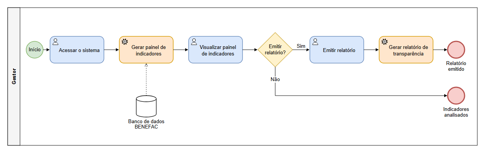
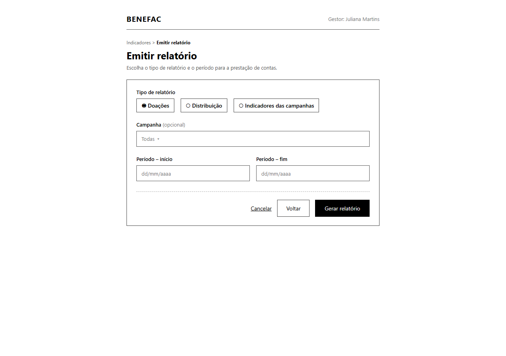

### 3.3.1 Processo 5 – ACOMPANHAMENTO, INDICADORES E TRANSPARÊNCIA

Este processo ocorre na Plataforma Web do BENEFAC e é realizado pelo Gestor/Coordenador Geral, a partir de computador ou notebook com conexão à internet. O processo tem início quando o Gestor acessa o sistema. Em seguida, o sistema gera o painel de indicadores de forma automática, consolidando os dados de doações, estoque e entregas registrados no banco de dados do BENEFAC pelos processos anteriores, e o Gestor visualiza o painel de indicadores. O Gestor decide se vai emitir um relatório: se não, o processo é encerrado com os indicadores analisados; se sim, ele emite o relatório, informando o tipo e o período, e o sistema gera o relatório de transparência automaticamente. O processo é encerrado quando o relatório é emitido, e os produtos gerados são o Painel de Indicadores e os Relatórios de Transparência.

Em seguida, apresenta-se o modelo do Processo 5, descrito no padrão BPMN.

##### 3.3.1.1 Modelagem BPMN

##### 3.3.1.2 Detalhamento das atividades do usuário (user tasks)

#### Detalhamento das atividades

**Atividade 1 – Acessar o sistema**
 
| **Campo**  | **Tipo**        | **Restrições** | **Valor default** |
| ---        | ---             | ---            | ---               |
| login      | Caixa de Texto  | obrigatório; formato de e-mail | |
| senha      | Caixa de Texto  | obrigatório; mínimo de 8 caracteres | |
 
| **Comandos**    | **Destino**                                      | **Tipo**  |
| ---             | ---                                              | ---       |
| entrar          | Atividade 2 – Visualizar painel de indicadores   | default   |
| recuperar senha | Tela de recuperação de senha                     |           |
 
**Atividade 2 – Visualizar painel de indicadores**
 
| **Campo**             | **Tipo**        | **Restrições** | **Valor default** |
| ---                   | ---             | ---            | ---               |
| campanha              | Seleção única   | lista das campanhas cadastradas; opcional | todas |
| periodo_inicio        | Data            | opcional; formato dd/mm/aaaa | dd/mm/aaaa |
| periodo_fim           | Data            | opcional; formato dd/mm/aaaa; posterior ao periodo_inicio | dd/mm/aaaa |
| quantidade_doacoes    | Número          | somente leitura | |
| produtos_recebidos    | Tabela          | somente leitura | |
| produtos_distribuidos | Tabela          | somente leitura | |
| campanhas_atendidas   | Número          | somente leitura | |
 
| **Comandos**     | **Destino**                                    | **Tipo**  |
| ---              | ---                                            | ---       |
| filtrar          | Atividade 2 – Visualizar painel de indicadores |           |
| emitir relatório | Atividade 3 – Emitir relatório                 | default   |
| cancelar         | Fim do Processo 5                              | cancel    |
 
**Atividade 3 – Emitir relatório**
 
| **Campo**       | **Tipo**        | **Restrições** | **Valor default** |
| ---             | ---             | ---            | ---               |
| tipo_relatorio  | Seleção única   | obrigatório; opções: Doações, Distribuição, Indicadores das campanhas | |
| campanha        | Seleção única   | lista das campanhas cadastradas; opcional | todas |
| periodo_inicio  | Data            | obrigatório; formato dd/mm/aaaa | dd/mm/aaaa |
| periodo_fim     | Data            | obrigatório; formato dd/mm/aaaa; posterior ao periodo_inicio | dd/mm/aaaa |
 
| **Comandos**     | **Destino**                                                  | **Tipo**  |
| ---              | ---                                                          | ---       |
| gerar relatório  | Gerar relatório de transparência (automática) e Fim do Processo 5 | default |
| voltar           | Atividade 2 – Visualizar painel de indicadores               |           |
| cancelar         | Fim do Processo 5                                            | cancel    |

##### 3.3.1.3 Wireframes (user tasks) 

